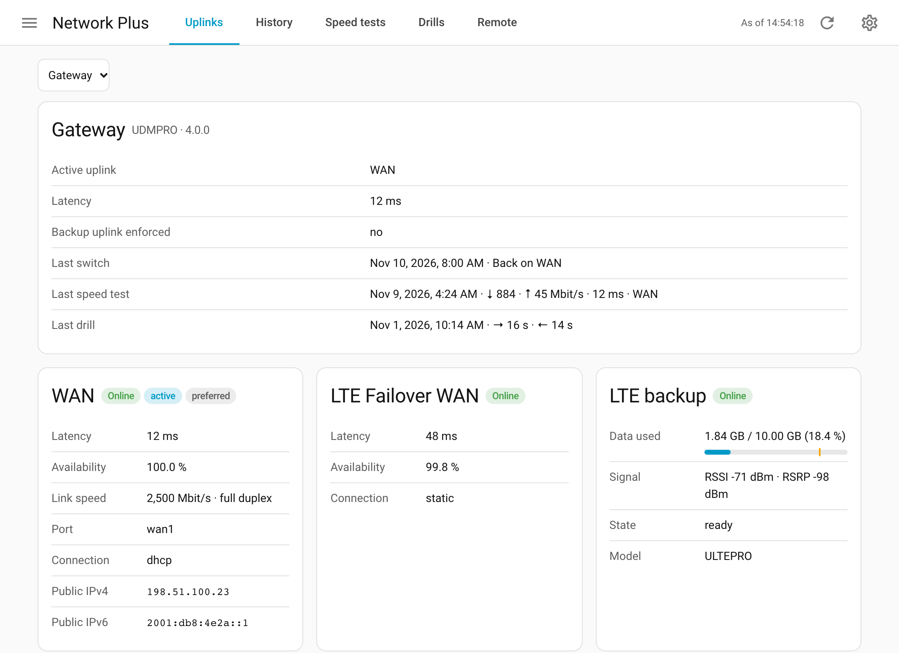
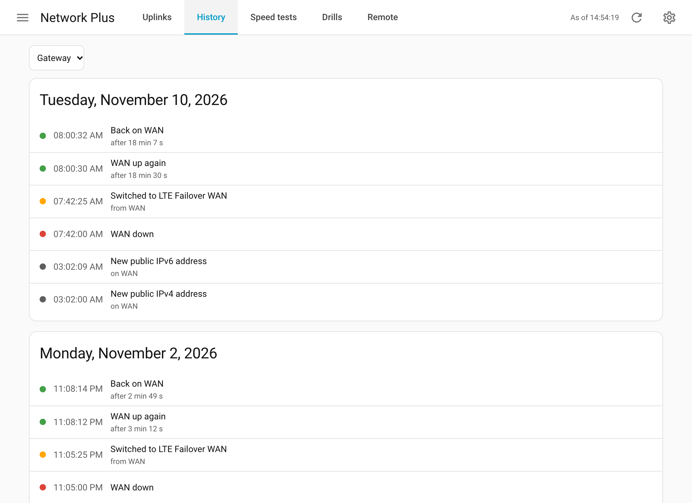
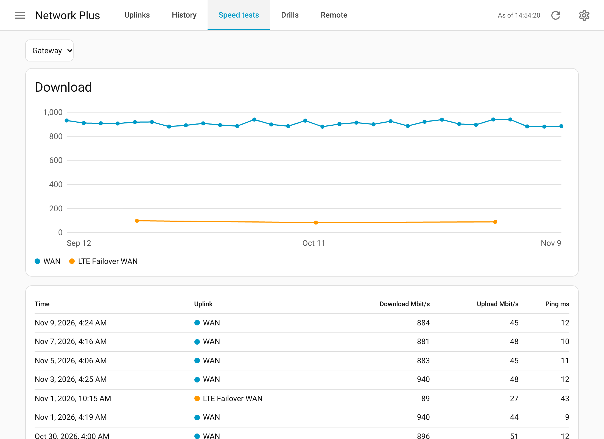
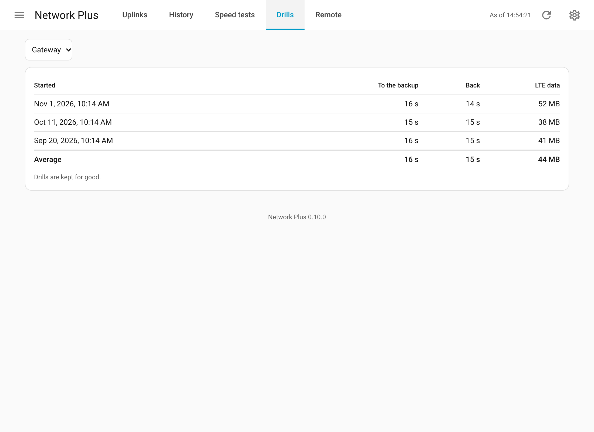
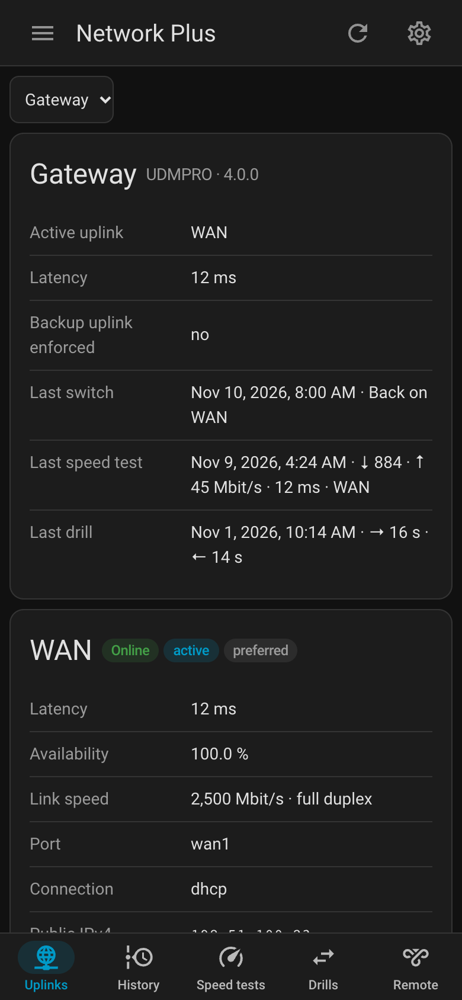
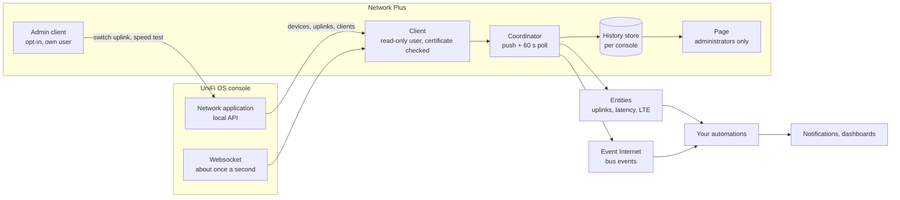
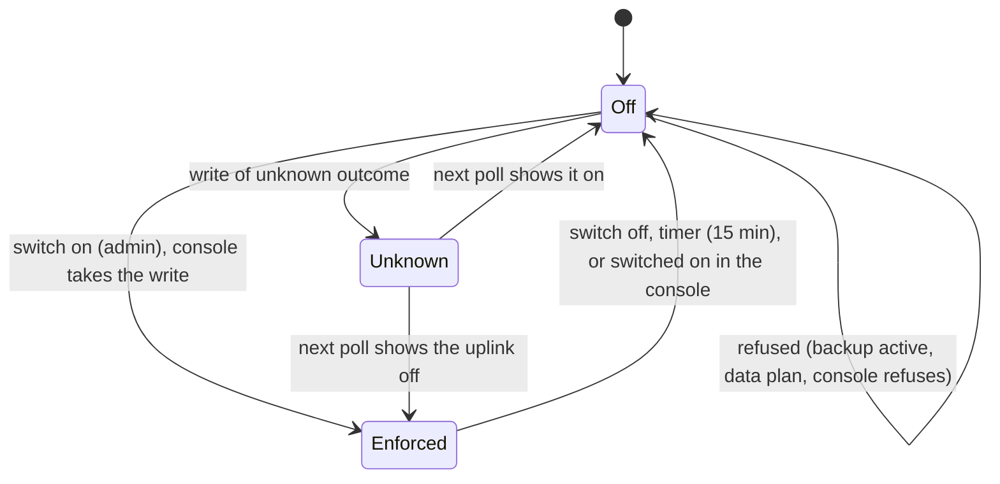
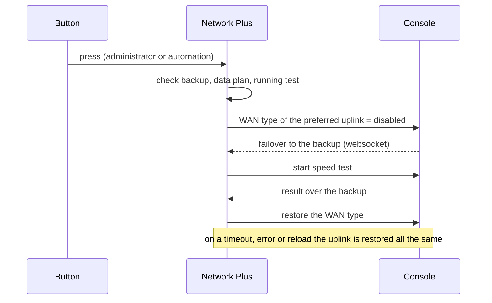

# Network Plus

[](#installation)

A Home Assistant integration that adds what the UniFi integration shipped with Home Assistant does not show: uplink status and failover, latency, buttons to run a speed test, also over the backup uplink, the LTE data plan and a page of its own with the uplinks' details and the history of failovers, speed tests, backup drills and remote sessions. It complements that integration, it does not replace it. This project is not affiliated with or endorsed by Ubiquiti.

What it is for, for example:

- a push when the gateway fails over to LTE, and an all clear when it is back;
- a latency alarm that knows a mobile backup is slower than the cable;
- a warning before the LTE data plan is used up, also with a billing day other than the 1st;
- a monthly drill: switch the cable off, measure the backup, switch it on again, all by itself;
- a dashboard that shows which uplink carries the traffic and since when.

## Screenshots

The page, made up for these pictures: the uplinks with the gateway's summary, the cable, the LTE uplink and the LTE backup's data plan:



The history of failovers, returns, outages and new public addresses, by day:



The speed tests per uplink over two months, and every result:



Every backup drill with failover time, return time, LTE data and the averages:



On a phone, in dark mode:



## Design

### Overview



Network Plus reads the console with a local read-only user and pushes what changes into Home Assistant: uplink states and failovers from the websocket at once, numbers from a poll every minute. It decides nothing; what counts as slow and who is told is up to your automations. It writes to the console only with the admin opt-in, through a second user, and only the three things described under [Admin features](#admin-features-opt-in).

### Uplinks and failover

Which internet uplink of the gateway is online, which one carries the traffic, and an event whenever the gateway fails over to its backup (for example LTE) or returns.

The built-in UniFi integration reports latency, but not whether an uplink is down or which one is active. A failover that lasts a few seconds is easy to miss by polling, so this integration listens to the console's websocket, which sends the gateway's state about once a second. Numbers (latency, speed test, data usage, remote clients) are sampled every 60 seconds instead, so the recorder is not flooded.

Entities are kept to what automations and dashboards need. The details (link speed, addresses, the gateway's own latency and availability per uplink) and the history (switches, speed tests, drills, remote sessions) are on [the page](#the-page).

A port that negotiated 1000 Mbit/s on a 2.5G line is a bad cable or a bad port, and nobody notices without looking. Set the speed each WAN port should negotiate in the integration's options (one field per WAN port the gateway reports, for example 2500); the problem sensor exists only for ports with a value. The page shows the negotiated speed of every port.

Only uplinks the gateway monitors get entities; a configured but unused WAN port has none. An uplink is reported offline only when the gateway says so. If the console cannot be reached, the entities become unavailable instead.

`brief_failover` fires when the gateway switched to the backup and back between two states the integration saw, for example while Home Assistant restarted.

### Speed test

The results of the gateway's speed tests are read; tests run in UniFi Network, by hand or on its schedule. With admin features, the button **"Run speed test"** starts one from Home Assistant (see [Admin features](#admin-features-opt-in)). A test that starts or finishes shows at once, not only with the next poll.

Every finished test is an entry of its own in the activity (the logbook), named with the result, for example `Gateway · ↓ 940 Mbit/s · ↑ 50 Mbit/s · 18 ms · WAN`, and a line in the page's speed test history. The uplink is the one the test ran over: the gateway names the test's interface only for a while after the test, so the integration notes the uplink when it first sees a result (from the interface, or the uplink that carries the traffic at that moment) and keeps it, also across restarts. A test that ran over the backup therefore does not pass for a measurement of the main line.

For automations the integration fires the event `network_plus_speedtest` with `download`, `upload` (Mbit/s), `ping` (ms), `last_run`, `uplink`, `uplink_name`, `gateway` and `entry_id`.

### Public addresses

The event `public_ip_changed` fires when an address of an uplink's port changes, with `family`, `address` and `previous`, so DynDNS or similar can follow. The two addresses reach automations but not the recorder, so history, logbook and backups do not keep them; the page's history names only the uplink and the family. An address that appears or vanishes, for example while an uplink is down, is no change. Behind another router this is a private address. The page shows the current addresses.

### LTE backup

If the console has an LTE backup device, it gets a device of its own below the gateway, with sensors for the data plan, the signal and the SIM (see [Interface](#interface)).

**Billing day.** The console counts LTE data per calendar month and resets on the 1st. If your mobile plan starts a new period on another day, set that day in the options (*LTE data plan: billing day*, 1 to 28). The integration then adds up the console's daily reports: the console's counter for the month, minus the days of the month before the billing day, or, before the billing day, plus the previous month's days since it. Closed days come from the reports, today from the counter, so the value stays current. The reports are read once an hour.

- "LTE data this month" then holds the bytes of the billing period, with the period's start as `last_reset`; the statistics reset on the billing day. The attribute `month_bytes` is the console's own monthly counter.
- "LTE data used" is the share of the billing period; the attribute `month_percent` is the share the console counts for the calendar month.
- The console's own warning and data limits keep resetting on the 1st; the integration cannot change that. "Enforce backup uplink" refuses as soon as either share reaches its limit; while the data limit is turned off in UniFi Network, it still goes by the plan size set there, if the console reports one.
- A day missing from the reports counts as used, so a warning comes early rather than late. If the reports cannot be read (the user needs read access to the statistics), the two sensors are unknown and the log says why.
- The console keeps the daily reports for 90 days by default, enough for any billing period.

### The page

**Network Plus** in the sidebar, for administrators. It shows one console at a time (a choice above the cards when there are several) and reads it again every 30 seconds while it is open. The header ends like on every page of these integrations and apps: the time the page last got its data ("As of 14:02:37", hidden on a phone), **Refresh** (reads the data again at once) and **Settings** (Home Assistant's page of the integration):

- **Uplinks**: the active uplink, latency, last switch, last speed test and last drill; per uplink its state, the gateway's latency and availability, the negotiated link speed against the expected one, port, connection type and public addresses; the LTE backup with data used against the plan and the signal.
- **History**: failovers and returns with how long the backup carried the traffic, brief failovers, uplinks going down and up with how long they were gone, new public addresses (the uplink and the family, not the address).
- **Speed tests**: download over time per uplink, and every result with upload and ping.
- **Backup drills**: every drill with failover time, return time and LTE data, and the averages.
- **Remote access**: the Teleport and VPN clients connected now, and the finished sessions.

The history is kept by the integration in a store of its own (`.storage/network_plus.history.<entry>`), not in the recorder, for 365 days (option *Keep history*, 1 to 3650 days); backup drills stay. It starts with the installation: nothing from before is shown. Removing the console removes its history.

At the bottom the page shows the version of the integration. The page is built from Home Assistant's own elements and follows its theme, dark mode and phone width; on a phone the tabs move to the bottom.

### Admin features (opt-in)

The integration reads by default and never writes. If you tick **Use admin features** during setup, a second dialog asks for **separate admin credentials**: a local user with the admin role for the Network application, stored apart from the read-only user. Only then the gateway gets two more entities.

The switch **"Enforce backup uplink"**: on switches the preferred uplink off in the console (its WAN type becomes `disabled`), so the gateway fails over to its backup; off switches it on again. That is a way to test the failover without pulling a cable.

The switch guards itself:

- it switches back by itself after **15 minutes** (option *switch back after*, 1 to 1440 minutes), also after a restart of Home Assistant;
- it refuses while the backup already carries the traffic, and from **80 %** of the LTE data plan on (option *refuse from an LTE usage of*);
- errors of the console come back as readable messages;
- only administrators of Home Assistant may use the switch and the buttons; automations and scripts may as well. A user without administrator rights gets an error, like for the page.

Everything that brings the uplink back is in place before the write: the type to restore, the start and the timer. If the console refuses the write, they go again. If its outcome is not known (a timeout, a server error after the write went out), they stay, and the switch shows within a minute what the console did; the timer switches the uplink on in any case. A start the console no longer shows (someone switched the uplink on in UniFi Network) is forgotten, so a later restart never touches a setting made in the console. An uplink switched off in UniFi Network, not here, is not switched on by Home Assistant: its connection type is known only to the console, and a guessed one (DHCP on a PPPoE line) would cut the line; the switch refuses and says so. Withdrawing the admin features (Reconfigure) is refused while the backup is enforced.

Mind the data: in a test, about 60 MB per minute ran over LTE while the backup was enforced. The attributes `enforced_since` and `auto_off_at` show what is going on.

**Drill protocol.** Every use of the switch is a drill of the failover. The integration times it, also across restarts: the seconds from switching the uplink off until the gateway routed over the backup, the seconds from switching it on again until the gateway routed over it (none if the uplink was switched on by hand in the console), and the LTE data it cost, from the console's monthly counter. Once the gateway is back, the drill is an entry in the activity, for example `Gateway · ⇄ · → 20 s · ← 12 s · 25 MB`, a line on the page, and the event "Internet" fires `drill_completed` with `started_at`, `failover_seconds`, `restore_seconds` and `data_used_bytes`. The bus event `network_plus_drill` carries the same with `gateway` and `entry_id`. Times come from Home Assistant's clock, so drills compare with each other.

The button **"Run speed test"** starts a speed test on the gateway, the same one UniFi Network runs on its schedule. It runs over the uplink that carries the traffic at that moment and takes well under a minute; the result arrives as soon as the gateway reports it. The button refuses while a test is running.

The button **"Run speed test over backup uplink"** measures the backup: it switches the preferred uplink off (the switch turns on, the drill begins), waits for the gateway to fail over, runs the speed test, waits for the result and switches the preferred uplink on again, whatever happened in between. The press returns at once; the attribute `in_progress` says that the measurement is going on. The result arrives like any other, with the backup as uplink, and the drill protocol records the data it cost. The button refuses what the switch refuses, a running test and a second measurement. If the gateway does not fail over within 90 seconds or reports no result within 3 minutes, the uplink comes back and a warning goes to the log. See [A speed test over the backup uplink](#a-speed-test-over-the-backup-uplink) for the data cost.





### Certificate

The console's certificate is checked by default (*Verify the certificate*): it needs a chain the system trusts. A publicly trusted certificate, for example one from Let's Encrypt for the console's host name, or one of your own CA in Home Assistant's trust store, is verified like that and needs nothing else; renewals do not matter. Enter the host name the certificate is for, not the IP address.

**Pinning** is optional and off by default. It fits a console with a certificate it made itself (self-signed, as UniFi OS does out of the box), which no system trusts. With *Pin the certificate*, a second step shows the certificate's SHA-256 fingerprint; compare it with the one the console shows (for example in a browser on the console's address: the lock or warning icon → certificate details) and enter it. From then on only that certificate is accepted. If it changes, for example after a reset of the console, the entities become unavailable, the log names the new fingerprint and Home Assistant asks again (Settings → Repairs or the integration's page); nothing is accepted by itself. Do not pin a certificate that is renewed regularly: a Let's Encrypt certificate changes every 90 days, and every renewal would ask again.

Turning the check off without a pin accepts any certificate: the connection is encrypted, but any device in the network could pose as the console and would get the passwords, the admin password too. Pin the console's own certificate instead.

Updating keeps the certificate settings of an existing entry as they are; nothing is pinned by itself.

### How the data is updated

The console's websocket pushes the gateway's state about once a second; the integration applies a push at once when an uplink, the active uplink, an address or the LTE state changed, or a speed test started or finished. Numbers (latency, data usage, remote clients) are read every 60 seconds. If the console cannot be reached, the entities become unavailable until the next successful read. A server error of the console (HTTP 5xx, for example while UniFi Network restarts) keeps the last state instead: the read is repeated up to five times, after 1, 2, 3, 4 and 5 minutes, and pushes still update the entities meanwhile; only when the fifth repeat fails do they become unavailable.

### Repair issues

Three things need a hand and get a repair issue under Settings → Repairs; each goes away by itself once the cause is gone:

| Issue | When | Gone when |
|---|---|---|
| Console not reachable | 15 polls in a row failed (about 15 minutes; with server errors about 30, the first quarter of an hour keeps the last state); the entities are unavailable meanwhile | The next poll succeeds |
| LTE data limit turned off | An LTE device has no data limit in UniFi Network, so "LTE data used" stays unknown; the switch still goes by the plan size, if the console reports one | The limit is turned on |
| Admin user cannot write | At setup the admin user lacks the admin role or its login is rejected, or the console refused a write of the switch or a button | A later setup finds the user working |

## Examples

The integration reports; it decides nothing. What counts as slow, when you want to be told and what a dashboard shows is yours to set, and Home Assistant's own building blocks are enough for it. The examples use the entity IDs of a gateway named "Gateway" with uplinks named "WAN" and "LTE Failover WAN" (the names UniFi Network gives them) and an LTE device named "LTE backup"; yours will differ.

### A helper that knows which uplink is active

A fixed latency threshold does not work across a failover: a mobile backup is normally several times slower than a wired line, and that alone is no problem. Create a [template helper](https://www.home-assistant.io/integrations/template/) (Settings → Devices & services → Helpers → Create helper → Template → Binary sensor) with a threshold per uplink. Look at a week of the latency sensor's history on each uplink and take about three times the usual value:

```jinja
# State template


{{ (uplink == 'wan' and latency > 50) or (uplink == 'wan_lte_failover' and latency > 250) }}

# Availability template
{{ has_value('sensor.gateway_active_uplink') and has_value('sensor.gateway_internet_latency') }}
```

Give it the device class "Problem". The availability template keeps the helper from reporting a problem while the console is unreachable. Leave the helper's own delays empty and put the duration into the automation, where it is visible.

### Automations

**Slow for a while, and all clear again.** With the Companion app, a `tag` makes a new message replace the old one instead of stacking, and `clear_notification` with the same tag removes it once the problem is over:

```yaml
triggers:
  - trigger: state
    entity_id: binary_sensor.internet_slow
    to: "on"
    for: "00:05:00"
    id: slow
  - trigger: state
    entity_id: binary_sensor.internet_slow
    to: "off"
    for: "00:05:00"
    id: normal
actions:
  - choose:
      - conditions:
          - condition: trigger
            id: slow
        sequence:
          - action: notify.mobile_app_phone
            data:
              title: Internet is slow
              message: >-
                {{ states('sensor.gateway_internet_latency') }} ms for 5 minutes
                over {{ state_attr('sensor.gateway_active_uplink', 'uplink_name') }}.
              data:
                tag: internet-slow
      - conditions:
          - condition: trigger
            id: normal
        sequence:
          - action: notify.mobile_app_phone
            data:
              message: clear_notification
              data:
                tag: internet-slow
```

**No internet at all.** The active uplink is `unknown` while no uplink is online. The push reaches the phone once the internet is back; a dashboard in the house shows the state at once.

```yaml
triggers:
  - trigger: state
    entity_id: sensor.gateway_active_uplink
    to: "unknown"
    for: "00:03:00"
```

**Data plan nearly used up.** A `numeric_state` trigger fires once when the value crosses the line. The condition keeps it quiet when the sensor comes back from `unavailable` with a value that is already above it:

```yaml
triggers:
  - trigger: numeric_state
    entity_id: sensor.lte_backup_lte_data_used
    above: 80
conditions:
  - condition: template
    value_template: "{{ trigger.from_state is not none and is_number(trigger.from_state.state) }}"
actions:
  - action: notify.mobile_app_phone
    data:
      message: "LTE backup: {{ states('sensor.lte_backup_lte_data_used') | round(0) }} % of the data plan used."
```

A second trigger with `below: 80` and a `clear_notification` removes the message after the monthly reset.

### LTE signal getting worse

Enable the sensor "LTE signal" (disabled by default; RSSI in dBm, closer to zero is better). An absolute threshold needs knowledge of the site; a comparison with the device's own history does not. A [statistics helper](https://www.home-assistant.io/integrations/statistics/) with the characteristic *mean* over the last 7 days gives the usual value, and a template helper says when the current one is clearly below it. Ten dB below the weekly mean is a different situation (an antenna moved, a mast off), not weather:

```jinja
# State template of a binary sensor "LTE signal degraded", device class Problem
{{ states('sensor.lte_backup_lte_signal') | float(0)
   < states('sensor.lte_signal_weekly_mean') | float(0) - 10 }}

# Availability template
{{ has_value('sensor.lte_backup_lte_signal') and has_value('sensor.lte_signal_weekly_mean') }}
```

```yaml
triggers:
  - trigger: state
    entity_id: binary_sensor.lte_signal_degraded
    to: "on"
    for: "00:30:00"
actions:
  - action: notify.mobile_app_phone
    data:
      title: LTE signal weaker than usual
      message: >-
        {{ states('sensor.lte_backup_lte_signal') }} dBm, usually
        {{ states('sensor.lte_signal_weekly_mean') | round(0) }} dBm.
      data:
        tag: lte-signal
```

A second trigger on `off` for 30 minutes with `clear_notification` and the same tag removes the message. The binary sensor "SIM problem" is the other thing worth an automation: it is the one LTE failure a reboot does not fix.

### A speed test over the backup uplink

Speed tests normally describe the main line: the gateway runs its scheduled tests over whatever uplink is active, and that is the preferred one nearly all the time. To know what the backup delivers, press **"Run speed test over backup uplink"**, by hand or on a schedule:

```yaml
alias: Measure the backup uplink monthly
triggers:
  - trigger: time
    at: "04:30:00"
conditions:
  - condition: template
    value_template: "{{ now().day == 1 }}"
actions:
  - action: button.press
    target:
      entity_id: button.gateway_run_speed_test_over_backup_uplink
mode: single
```

The result arrives a minute or two later, with the backup as uplink, in the activity and on the page. An automation that wants to tell you listens to the event and checks the uplink:

```yaml
triggers:
  - trigger: event
    event_type: network_plus_speedtest
    event_data:
      uplink: wan_lte_failover
actions:
  - action: notify.mobile_app_phone
    data:
      title: Backup uplink measured
      message: >-
        {{ trigger.event.data.download | round(0) }} Mbit/s down,
        {{ trigger.event.data.upload | round(0) }} Mbit/s up,
        {{ trigger.event.data.ping }} ms.
```

**Mind the data.** A speed test moves data at full speed for some seconds in each direction. Over a mobile backup that is a noticeable share of a data plan, typically some tens to a few hundred megabytes, on top of what the drill itself costs; the drill on the page shows the sum afterwards. The button refuses from the configured share of the data plan on, and the drill ends by itself after the configured time (*switch back after*) even if Home Assistant restarts in the middle.

### Dashboard

Native cards are enough. The tile for the active uplink shows the uplink's name from UniFi Network and how long it has carried the traffic. The conditional card appears only while the backup is active. The gauge uses the same limits as the automation. The history graph is what the latency sensor is for: one line across failovers, with the uplinks' online state underneath.

```yaml
- type: tile
  entity: sensor.gateway_active_uplink
  state_content:
    - uplink_name
    - last_changed
- type: tile
  entity: sensor.gateway_internet_latency
- type: conditional
  conditions:
    - condition: state
      entity: binary_sensor.gateway_backup_uplink_active
      state: "on"
  card:
    type: tile
    entity: sensor.lte_backup_lte_data_used
    name: Backup uplink active – data plan used
    color: orange
- type: gauge
  entity: sensor.lte_backup_lte_data_used
  needle: true
  severity:
    green: 0
    yellow: 80
    red: 95
- type: history-graph
  hours_to_show: 24
  entities:
    - entity: sensor.gateway_internet_latency
    - entity: binary_sensor.gateway_wan
    - entity: binary_sensor.gateway_lte_failover_wan
- type: tile
  entity: event.gateway_internet
  state_content:
    - event_type
    - state
```

With admin features, the switch and the buttons ask before they act:

```yaml
- type: tile
  entity: switch.gateway_enforce_backup_uplink
  tap_action:
    action: toggle
    confirmation:
      text: Switch the preferred uplink off in the console?
- type: tile
  entity: button.gateway_run_speed_test
  tap_action:
    action: perform-action
    perform_action: button.press
    target:
      entity_id: button.gateway_run_speed_test
    confirmation:
      text: Start a speed test on the gateway?
- type: tile
  entity: button.gateway_run_speed_test_over_backup_uplink
  tap_action:
    action: perform-action
    perform_action: button.press
    target:
      entity_id: button.gateway_run_speed_test_over_backup_uplink
    confirmation:
      text: Switch to the backup uplink and measure it? This costs mobile data.
```

## Known limitations

- Only uplinks the gateway monitors get entities; a configured but unused WAN port has none.
- The page shows the uplink port's address. Behind another router this is a private address.
- The page's history starts with the installation and is kept per console in Home Assistant's storage, not in the recorder; a backup of Home Assistant contains it.
- The only writes are the switch "Enforce backup uplink" and the two speed test buttons, and only with the admin opt-in. A speed test runs over the active uplink; the console offers no way to pick one, which is why the backup is measured by switching the preferred uplink off.
- Remote clients are those the console lists as connected; of VPN servers only Teleport was tested.
- Events are derived from state changes, not from the console's event log; packet loss and "failed multiple times" are not reported.

## Troubleshooting

- **"The console does not answer"**: check the address.
- **"The console's certificate is not trusted"**: for a certificate the console made itself, tick *Pin the certificate*; for a publicly trusted one, enter the host name it is for (see [Certificate](#certificate)).
- **The fingerprint does not match**: compare once more with the console's certificate. If it really differs, another device answers at this address; do not go on.
- **"The console rejected the username or the password"**: the user must be a local user of the console, not a UI.com account.
- **Home Assistant asks for the password although it did not change**: the console rejected the login three polls in a row. The log says why (`login rejected (401)`, a code of the console, or `session not accepted after a new login`). A single rejection, for example when the console's two-hour session expires during maintenance, is retried without asking.
- **Entities unavailable**: the console was not reachable at the last read; look at Settings → System → Logs for `network_plus`. A warning `answered with a server error … repeat 1 of 5` means the console answered with HTTP 5xx and the last state is kept for now.
- **`Cannot connect … DNS` after the console restarted, although it answers again**: the console's host name exists only in its local DNS. While the console restarts, the DNS plugin of Home Assistant OS falls back to a public resolver, which answers that the name does not exist, and Home Assistant keeps that answer for up to the zone's negative TTL (often 30 minutes or more). Restarting Home Assistant clears it; restarting the DNS plugin does not. To avoid it, enter the console's IP address as host (Reconfigure), or turn the fallback off with `ha dns options --fallback=false`.
- The diagnostics (⋮ on the integration's page → Download diagnostics) hold no address, user, password, MAC, uplink names or times and can be attached to an issue.

## Interface

### Entities

Of the gateway:

| Entity | What it shows |
|---|---|
| Binary sensor per uplink, named like the uplink in UniFi Network | Online or offline, as the gateway sees it |
| Binary sensor "Backup uplink active" | On while another uplink than the preferred one carries the traffic |
| Sensor "Active uplink" | `wan`, `wan2`, `wan_lte_failover`, …; the attribute `uplink_name` holds the name set in UniFi Network |
| Sensor "Internet latency" | Latency on the uplink that carries the traffic, one series across failovers |
| Event "Internet" | `failover`, `restored`, `brief_failover`, `uplink_down`, `uplink_up`, `public_ip_changed`, `drill_completed` |
| Binary sensor "<uplink> link slower than expected" | Only with an expected link speed in the options: on while the port negotiated less than that, or half duplex. A link that is down is not slow; the sensor is unknown then |

With the admin opt-in, for administrators and automations only:

| Entity | What it does |
|---|---|
| Switch "Enforce backup uplink" | On switches the preferred uplink off in the console; attributes `enforced_since` and `auto_off_at` while on |
| Button "Run speed test" | Starts a speed test over the active uplink |
| Button "Run speed test over backup uplink" | Measures the backup; attribute `in_progress` |

Of an LTE backup device:

| Entity | What it shows |
|---|---|
| Sensor "LTE data used" | Share of the data plan used this month (or billing period, see below), in percent. Unknown while the limit is turned off |
| Sensor "LTE data this month" | Bytes used this month, as the console counts them; the monthly drop is the reset. With a billing day: the bytes of the billing period |
| Sensor "LTE data limit" (diagnostic) | The data plan set in UniFi Network; attribute `warning_bytes` is the warning limit. Unknown while the limit is turned off |
| Sensor "LTE signal" (diagnostic, disabled) | RSSI in dBm; attribute `rsrp` |
| Binary sensor "SIM problem" | On while the SIM keeps the device from connecting: a PIN the device could not verify, or no PIN tries left (the SIM wants its PUK). Attributes `state` and `pin_tries_left` |

### Events

| Event | Data |
|---|---|
| Event entity "Internet" | `failover`, `restored` (`from_uplink`, `to_uplink` and their names), `brief_failover` (`at`), `uplink_down`, `uplink_up` (`uplink`, `uplink_name`), `public_ip_changed` (`uplink`, `uplink_name`, `family`, `address`, `previous`; the last two not recorded), `drill_completed` (`started_at`, `failover_seconds`, `restore_seconds`, `data_used_bytes`) |
| Bus event `network_plus_speedtest` | `download`, `upload` (Mbit/s), `ping` (ms), `last_run`, `uplink`, `uplink_name`, `gateway`, `entry_id` |
| Bus event `network_plus_drill` | as `drill_completed`, with `gateway` and `entry_id` |

### WebSocket command

`network_plus/overview` (administrators only), optional `entry_id`: the consoles, the chosen one's uplinks, LTE backup, remote clients and history, and the integration's `version`. The page reads it every 30 seconds while it is open.

## Installation

1. **Settings → Marketplace → Add from link** (top right), enter `https://github.com/n-schilling/ha-network-plus` as GitHub link and add it. Adding a repository by link asks you to connect GitHub once.
2. Install **Network Plus** in the Marketplace and restart Home Assistant.
3. **Settings → Devices & services → Add integration → Network Plus.**

Requires Home Assistant 2026.11 or later. Without the Marketplace, copy `custom_components/network_plus` into the `custom_components` folder of your configuration directory and restart. There are no requirements outside Home Assistant.

You need a UniFi OS console with a gateway (Dream Machine, Cloud Gateway, UXG) and UniFi Network 10, and a local user of the console; the read-only role is enough. Accounts of UI.com do not work. Developed against a Dream Machine with UniFi Network 10.

### Installation parameters

| Parameter | Description |
|---|---|
| Host | IP address or host name of the console, for example 192.168.1.1. |
| Username | A local user of the console. Create one under UniFi OS → Admins & Users with local access only and the read-only role for the Network application; accounts of UI.com do not work. |
| Password | The password of that user. |
| Verify the certificate | On by default: the certificate needs a chain the system trusts. Off accepts any certificate; see [Certificate](#certificate). |
| Pin the certificate | Off by default. For a console with a certificate of its own: a second step asks for its fingerprint, and only that certificate is accepted. Not for a certificate that is renewed regularly. |
| Use admin features | Off by default. On, a second dialog asks for the admin credentials for the switch "Enforce backup uplink" and the two speed test buttons; see [Admin features](#admin-features-opt-in). |

The entry is named after the gateway. Reconfigure changes the address, the user, the certificate settings or the admin opt-in; when the read-only password changes, Home Assistant asks for the new one. The options hold the two limits of "Enforce backup uplink", the billing day of the LTE data plan, the expected link speeds and how long the page keeps its history. While the console cannot be reached the options show no link speeds; the ones set stay.

### Removal

**Settings → Devices & services → Network Plus → ⋮ → Delete** removes the console, its devices and entities and its history; the page goes with the last console. Then remove the integration in the Marketplace and restart. Nothing is left on the console: without the admin opt-in the integration never writes to it, and with it the switch only changes the WAN type of the preferred uplink, which it restores when switched off.

## Development

```bash
uv venv --python 3.14 && uv pip install -r requirements_test.txt
scripts/check.sh
```

`scripts/check.sh` runs what CI runs: ruff, the changelog and translation checks, mypy, the tests with their coverage threshold, the page checks and hassfest in Docker.

The page checks start two made-up consoles (HTTPS on 127.0.0.1 with their own certificates) and a throwaway Home Assistant, reachable from this machine only, add the consoles through the config flow (one pinned, one with the check off), and drive the page in a headless browser (all tabs, the header with stamp, refresh and settings, the console choice, version line, phone width, dark mode, no page and no admin writes for non-administrators), then stop Home Assistant again. They need their own environment:

```bash
uv venv --python 3.14 .venv-panel && uv pip install --python .venv-panel/bin/python -r requirements_panel.txt
```

They use an installed Google Chrome, otherwise Playwright's Chromium (`.venv-panel/bin/python -m playwright install chromium`). The pictures in this README come from the same run:

```bash
.venv-panel/bin/python -I scripts/panel/check_panel.py --screenshots docs/screenshots
```

[ARCHITECTURE.md](ARCHITECTURE.md) explains the data sources, the push/poll design, the decisions taken on purpose and what is not verified yet.

Releases: CI on `main` tags the version from `manifest.json` and publishes a GitHub release with its CHANGELOG section; the Marketplace offers it as an update.

## License

[Apache 2.0](LICENSE)
